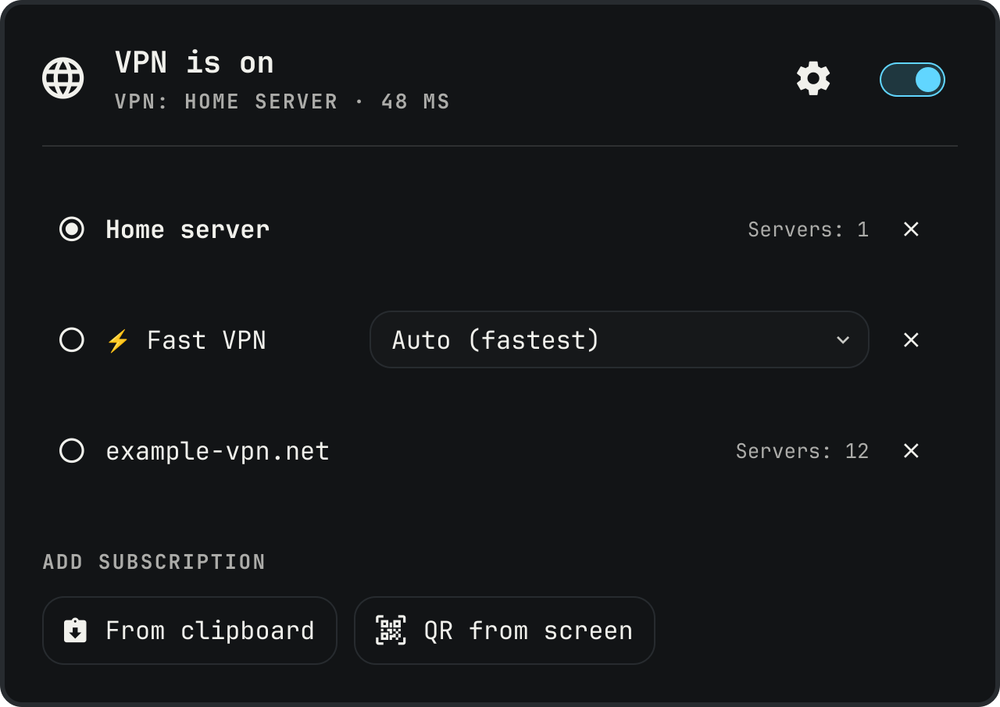

# VPN (mihomo) for Omarchy

An Omarchy shell plugin that runs your VPN through [mihomo](https://github.com/MetaCubeX/mihomo) in TUN mode: the whole machine's traffic goes through mihomo, and mihomo decides per rule what goes through the VPN and what goes direct. No app needs a proxy setting.

- **On/off** — the icon's right click, or the switch at the right of the window header (left click opens the window, a modal in the middle of the screen). Keys in the window: ↑/↓ subscription (↑ from the first one: the header, ←/→ between the gear and the switch), Enter use it, Delete remove it (asks first), Esc back (a click outside closes).
- **Subscriptions** — add a subscription URL or proxy links (`hy2://`, `vless://`, `trojan://`, … — whatever mihomo parses) from the clipboard or from a QR code on screen. Pick the active subscription by hand; when none of its servers answers, mihomo moves to the next live subscription (`fallback`, checked every minute) and back once yours recovers — the icon's tooltip names the one in use. Inside a subscription mihomo keeps the fastest server (`url-test`) and switches when one dies.
- **Rules** — behind the gear in the header (Back or Esc returns): a country whose sites go direct (Russia, or none), ad blocking, switching to a working subscription (on by default; off — only the one you picked), and your own "always through VPN" / "always direct" domain lists (subdomains included). Private networks (LAN, corporate VPNs, Tailscale) always go direct.
- **Bypass, in `state.json` for now** — `directPorts` (default `[51413]`, Transmission's peer port) and `directApps` (default: Transmission and qBittorrent). Packets from those ports never enter TUN; those apps go `DIRECT` by process name. That is how torrents stay off the VPN.

No logs, server picker or other settings in the UI on purpose.



## Install

Requirements: `mihomo-bin` (AUR), `slurp`, `grim`, `zbar`, `wl-clipboard`, `curl` ≥ 8.3, `libnotify`.

```bash
git clone https://github.com/predmaxim/omarchy-vpn.git ~/.config/omarchy/plugins/predmaxim.vpn
yay -S mihomo-bin
sudo install -Dm644 ~/.config/omarchy/plugins/predmaxim.vpn/systemd/override.conf \
  /etc/systemd/system/mihomo@.service.d/override.conf
sudo install -Dm644 ~/.config/omarchy/plugins/predmaxim.vpn/systemd/50-mihomo-restart.rules \
  /etc/polkit-1/rules.d/50-mihomo-restart.rules
omarchy bar put predmaxim.vpn      # first: the widget creates ~/.config/mihomo (config + API secret)
sudo systemctl daemon-reload && sudo systemctl enable --now mihomo@$USER
```

`override.conf` makes the packaged `mihomo@.service` run as you on `~/.config/mihomo` with only the network capabilities TUN needs (the packaged unit runs as root on `/etc/mihomo` with far more), and restarts it forever if it exits. `50-mihomo-restart.rules` lets you (local, active session) restart your own `mihomo@<you>` unit without a password, and nothing else: that is how the widget applies a change.

## How it works

- `~/.config/mihomo/state.json` — your subscriptions, the active one, on/off, rules and the API secret. The widget builds `config.yaml` (and `links/*.txt` for plain links) from it. Everything there is `0600` and holds subscription keys: keep it out of git.
- The widget talks to mihomo's REST API on `127.0.0.1:9097`. A change (VPN on included) restarts the service on the new files, then waits up to 20 s for the API and, when on, for TUN; if mihomo does not come up, the previous settings go back the same way. Not a hot reload (`PUT /configs`): reloading the TUN at times left mihomo unable to reach anything, direct or VPN, until a restart. Not a runtime TUN toggle for on either: that leaves Hysteria2's QUIC socket unbound to the uplink, and its packets loop into the tunnel. VPN off is the runtime toggle (`PATCH`), no restart.
- With Russia as the country, its IPv4 networks (~13k, [MetaCubeX `geoip/ru.list`](https://github.com/MetaCubeX/meta-rules-dat/blob/meta/geo/geoip/ru.list)) go into `tun.route-exclude-address`: the kernel sends them past TUN, so Russian traffic costs mihomo nothing (gVisor costs CPU even for `DIRECT`). The list is downloaded to `~/.config/mihomo/cidrs-ru.txt` when missing or a week old, on the next change; without it Russian sites still go direct by mihomo's own rules. Only `a.b.c.d/n` lines are used.
- TUN uses the `gvisor` stack: with `system`/`mixed`, connections hung — most likely ufw dropping what arrives on the TUN device (`DEFAULT_INPUT_POLICY="DROP"`), not `rp_filter`.
- Retries: a dead current server re-tests its group, an empty subscription re-downloads — after 5 s, 15 s, 60 s, then every 5 minutes. The icon is orange between states: while a change is applied, before the current server's first test, and while the quick retries (5 s, 15 s, 60 s) run. It turns red when the service is down, or a subscription still has no servers or none answers after them.

## IPC

```bash
omarchy-shell predmaxim.vpn toggle            # the window (open / close too)
omarchy-shell predmaxim.vpn-ctl power         # VPN on/off
omarchy-shell predmaxim.vpn-ctl use <id>      # active subscription (ids in state.json)
omarchy-shell predmaxim.vpn-ctl add '<text>'  # add a subscription URL or links
```

## Tests

```bash
node test.js
```
