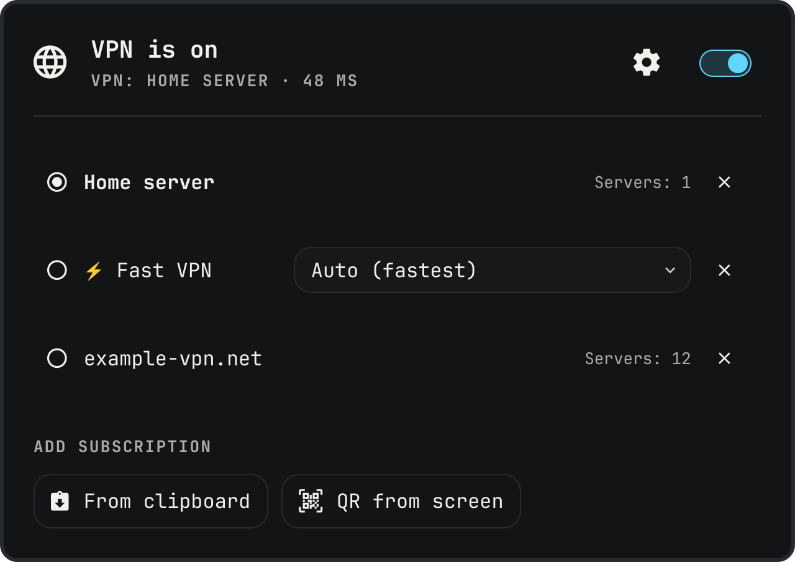

# VPN (mihomo) for Omarchy

An Omarchy shell plugin that runs your VPN through [mihomo](https://github.com/MetaCubeX/mihomo) in TUN mode: the whole machine's traffic goes through mihomo, and mihomo decides per rule what goes through the VPN and what goes direct. No app needs a proxy setting.

- **On/off** — the icon's right click, or the switch at the right of the window header (left click opens the window, a panel under the bar icon like the stock Wi-Fi one). Keys in the window: ↑/↓ subscription (↑ from the first one: the header, ←/→ between the status line, the gear and the switch), ←/→ on a subscription with locations: its location, Enter use it, Delete remove it (asks first); ↓ past the last one: the two add buttons, halves of the full width (←/→ between them, Enter presses one); Esc back (a click outside closes). On the rules page (the gear): ↑/↓ rows (the country, the two switches, each list's field and its entries), ←/→ or Enter change the country or a switch, Enter on a field puts the cursor in it (Enter adds the entry, Esc clears, then leaves), Enter or Delete on an entry removes it.
- **Delay** — the status line under the header (subscription · server · delay) re-checks on a click or Enter: mihomo tests the subscription's servers now (and keeps the fastest), `…` stands in for the delay until the answer. A subscription with no servers is downloaded again instead.
- **Subscriptions** — add a subscription URL or proxy links (`hy2://`, `vless://`, `trojan://`, … — whatever mihomo parses) from the clipboard or from a QR code on screen. Pick the active subscription by hand (the pick restarts mihomo, a second or two offline: the new config puts it first in the `fallback` order — a pick through the API alone mihomo drops on the next group test); when none of its servers answers, mihomo moves to the next live subscription (`fallback`, checked every minute) and back once yours recovers — the icon's tooltip names the one in use, and the list marks it, not the one you picked. Inside a subscription mihomo keeps the fastest server (`url-test`) and switches when one dies; every subscription is tested on its interval even while unused (`lazy: false`), so the switch lands on one already measured.
- **Subscriptions with locations (Xray JSON)** — some services answer the subscription URL with a JSON array of whole Xray configs, one per location (Happ and v2rayN read those). mihomo can't use their servers (their REALITY lets in Xray-core clients only), so the plugin runs [Xray](https://github.com/XTLS/Xray-core) for them and mihomo goes through it. The location is picked in a dropdown on the subscription's row (or ←/→): **Auto (fastest)** — mihomo tests every location and keeps the fastest that answers, moves to the next fastest when it dies, and to the next subscription when none answers; or one location by hand. Auto skips the locations of the country set to go direct (its flag in front, "🇷🇺 …" for Russia): such a location exits there, blocked sites stay blocked through it, and being the closest it would win every test. By hand it can still be picked. Picking restarts nothing. The widget downloads such a subscription again every `profile-update-interval` (an hour by default).
- **Rules** — behind the gear in the header (Back or Esc returns): a country whose sites go direct (Russia, or none), ad blocking, switching to a working subscription (on by default; off — only the one you picked), and your own "always through VPN" / "always direct" lists: domains (subdomains included), and in "always through VPN" also IP addresses and networks (below; "always direct" refuses them with a pointer there). Private networks (LAN, corporate VPNs, Tailscale) always go direct.
  An IP or a network in "always through VPN" (marked "only VPN" in the list) is held harder than a domain. It takes IPv4 and IPv6 addresses and networks (`160.79.104.0/23`, `2607:6bc0::/48`; not private networks, not wider than `/8` or `/16`): they are reached only through the VPN, and while it is off or down every connection to them is refused at once, by any program, mihomo's own `DIRECT` too (needs `vpn-guard`, see Install). The widget reloads the guard before it restarts mihomo; the globe turns red when the guard is down, until it is active again (checked every minute), and when the widget's reload of it fails while it stays active (a notification says so, the rest of the change still goes in), until a reload goes through. Limits:
  - addresses, not names: a service behind a shared CDN (Cloudflare) has no addresses of its own, and its addresses change without notice; Anthropic publishes its own ([IP addresses](https://platform.claude.com/docs/en/api/ip-addresses): `160.79.104.0/23`, `153.61.224.0/22`, `2607:6bc0::/48`);
  - IPv6 to them is always refused: mihomo carries no IPv6 (`ipv6: false`), so apps fall back to IPv4 at once;
  - an address in the country's networks (sent past TUN) stays unreachable, VPN or not; private networks stay open whatever the list says;
  - never list your VPN servers: mihomo reaches them past TUN, and the guard would cut the VPN off;
  - DNS queries for their names still go to the router's DNS, past the VPN.
- **Bypass, in `state.json` for now** — `directPorts` (default `[51413]`, Transmission's peer port) and `directApps` (default: Transmission and qBittorrent). Packets from those ports never enter TUN; those apps go `DIRECT` by process name. That is how torrents stay off the VPN.

No logs, server picker (beyond locations) or other settings in the UI on purpose.



## Install

Requirements: `mihomo-bin` (AUR), `slurp`, `grim`, `zbar`, `wl-clipboard`, `curl` ≥ 8.3, `libnotify`; for subscriptions with locations also `xray-bin` (AUR); for VPN-only addresses also `nftables`.

```bash
git clone https://github.com/predmaxim/omarchy-vpn.git ~/.config/omarchy/plugins/predmaxim.vpn
yay -S mihomo-bin
sudo install -Dm644 ~/.config/omarchy/plugins/predmaxim.vpn/systemd/override.conf \
  /etc/systemd/system/mihomo@.service.d/override.conf
sudo install -Dm644 ~/.config/omarchy/plugins/predmaxim.vpn/systemd/50-mihomo-restart.rules \
  /etc/polkit-1/rules.d/50-mihomo-restart.rules
omarchy bar put predmaxim.vpn      # first: the widget creates ~/.config/mihomo (config + API secret)
sudo systemctl daemon-reload && sudo systemctl enable --now mihomo@$USER
# subscriptions with locations (Xray JSON) only:
yay -S xray-bin
install -Dm644 ~/.config/omarchy/plugins/predmaxim.vpn/systemd/mihomo-xray@.service \
  ~/.config/systemd/user/mihomo-xray@.service
systemctl --user daemon-reload
# VPN-only addresses only:
sudo pacman -S --needed nftables
cd ~/.config/omarchy/plugins/predmaxim.vpn
sudo install -Dm755 guard/vpn-guard /usr/local/lib/omarchy-vpn/vpn-guard
sudo install -Dm644 systemd/vpn-guard@.service /etc/systemd/system/vpn-guard@.service
sudo install -Dm644 systemd/50-mihomo-restart.rules /etc/polkit-1/rules.d/50-mihomo-restart.rules
sudo systemctl daemon-reload && sudo systemctl enable --now vpn-guard@$USER
```

`override.conf` makes the packaged `mihomo@.service` run as you on `~/.config/mihomo` with only the network capabilities TUN needs (the packaged unit runs as root on `/etc/mihomo` with far more), and restarts it forever if it exits. `50-mihomo-restart.rules` lets you (local, active session) restart your own `mihomo@<you>` unit and reload your own `vpn-guard@<you>` without a password, and nothing else: that is how the widget applies a change. `mihomo-xray@.service` is a user unit: one Xray per subscription with locations, which the widget enables, restarts and stops itself.

`vpn-guard`, run as root by `vpn-guard@<you>.service` at boot (before the network) and on the widget's reload, reads `~/.config/mihomo/vpn-addresses.txt` (as you, at most 64 KB; lines other than an address with its `/prefix`, or wider than `/8`, `/16`, skipped; no file is an empty list) and replaces the `nftables` table `inet vpn_guard` in one transaction. A file it cannot read, or a network `nft` refuses, fails the start or reload, and a failed reload leaves the table as it was. It is root's copy in `/usr/local/lib/omarchy-vpn/`: root runs nothing from the plugin's folder, which you can write to. So `git pull` does not update it: when `guard/` or `systemd/` change, repeat the steps above and `sudo systemctl reload vpn-guard@$USER`.

## How it works

- `~/.config/mihomo/state.json` — your subscriptions, the active one, on/off, rules and the API secret. The widget builds `config.yaml` (and `links/*.txt` for plain links) from it. Everything there is `0600` and holds subscription keys: keep it out of git.
- The widget talks to mihomo's REST API on `127.0.0.1:9097`. A change (VPN on included) restarts the service on the new files, then waits up to 20 s for the API and, when on, for TUN; if mihomo does not come up, the previous settings go back the same way. Not a hot reload (`PUT /configs`): reloading the TUN at times left mihomo unable to reach anything, direct or VPN, until a restart. Not a runtime TUN toggle for on either: that leaves Hysteria2's QUIC socket unbound to the uplink, and its packets loop into the tunnel. VPN off is the runtime toggle (`PATCH`), no restart.
- With Russia as the country, its IPv4 networks (~13k, [MetaCubeX `geoip/ru.list`](https://github.com/MetaCubeX/meta-rules-dat/blob/meta/geo/geoip/ru.list)) go into `tun.route-exclude-address`: the kernel sends them past TUN, so Russian traffic costs mihomo nothing (gVisor costs CPU even for `DIRECT`). The list is downloaded to `~/.config/mihomo/cidrs-ru.txt` when missing or a week old, on the next change; without it Russian sites still go direct by mihomo's own rules. Only `a.b.c.d/n` lines are used.
- Domain rules match on the name mihomo reads from the connection itself (`sniffer`: TLS and QUIC SNI, HTTP Host). Apps resolve through the system DNS — the router, a private network that goes past TUN — so `dns-hijack` never sees the query and mihomo gets a bare IP: without sniffing no domain rule (your lists, the country's sites, ad blocking) matched at all, only the IP ones. The connection still goes to the IP the app resolved.
- TUN uses the `gvisor` stack: with `system`/`mixed`, connections hung — most likely ufw dropping what arrives on the TUN device (`DEFAULT_INPUT_POLICY="DROP"`), not `rp_filter`.
- A subscription with locations: the widget keeps its locations in `state.json` — each location's servers and how its config picks one for the rest of the traffic (its last rule without conditions, with its balancer); the location's other rules (sites that go direct) are dropped, that is mihomo's to decide. It writes `xray/<id>.json`: every location behind a SOCKS port of its own on `127.0.0.1` (a block of 100 from 17900, one block per subscription), the API secret the password, tags prefixed with the location's index. mihomo gets `links/<id>.txt` — a SOCKS server per location, named after it (all of them for Auto, else the picked one) — and re-reads it on a pick (`PUT /providers/proxies/<id>`), no restart. Xray (`mihomo-xray@<id>`) restarts only when its config changes: fresh servers, ports or the secret. Its own traffic to the servers comes back through TUN and goes out by `PROCESS-NAME,xray,DIRECT`. Files reach the writer in 32k-character parts of the environment: one variable holds 128 KiB, and `state.json` with such a subscription runs to ~80 KB.
- Retries: a dead current server re-tests its group, an empty subscription re-downloads — after 5 s, 15 s, 60 s, then every 5 minutes. The icon is orange between states: while a change is applied, before the current server's first test, and while the quick retries (5 s, 15 s, 60 s) run. It turns red when the service is down, VPN-only addresses are listed and their guard is down (see Rules), or a subscription still has no servers or none answers after them.
- VPN-only addresses are held by `nftables`, not by mihomo alone. mihomo sends them to `VPN` by its first rules (`IP-CIDR`, `IP-CIDR6`, before `xray` and `directApps`). The table `inet vpn_guard` (hooks `output` and `forward`, so containers and VMs too) lets a packet to a listed network out only through `lo` and `Meta` (the TUN) and refuses the rest at once — a TCP reset, an ICMP error for the rest. With mihomo down or TUN off they get an error, never a direct connection. Private networks pass before the list. Emergency exit: `sudo systemctl stop vpn-guard@$USER` removes the table; a failed or timed-out start removes it by itself (`ExecStopPost=`).

## Colours

Status colours (red, orange) are fixed rather than the theme's, whose red or
yellow can be any colour: `FixedColors.qml` reads them from
`~/.config/omarchy/predmaxim/palette.json` (`{"red": "#e5534b", ...}`) and
falls back to the theme's alert colour (red) and `#e0823d` (orange) without that file.

## IPC

```bash
omarchy-shell predmaxim.vpn toggle            # the window (open / close too)
omarchy-shell predmaxim.vpn-ctl power         # VPN on/off
omarchy-shell predmaxim.vpn-ctl use <id>      # active subscription (ids in state.json)
omarchy-shell predmaxim.vpn-ctl add '<text>'  # add a subscription URL or links
```

## Tests

```bash
node test.js
guard/test.sh         # vpn-guard's table in a network namespace of its own: no root, the machine's network untouched
sudo guard/check.sh   # vpn-guard installed and active, VPN on: real connections, PASS or FAIL per check
```
